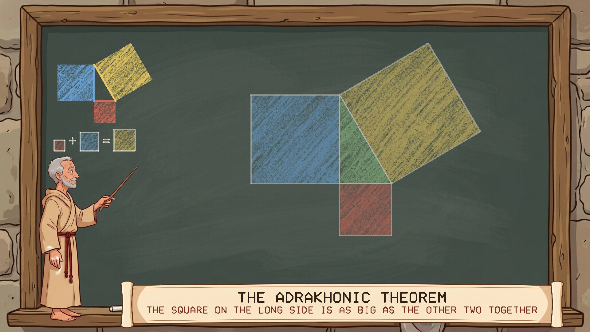
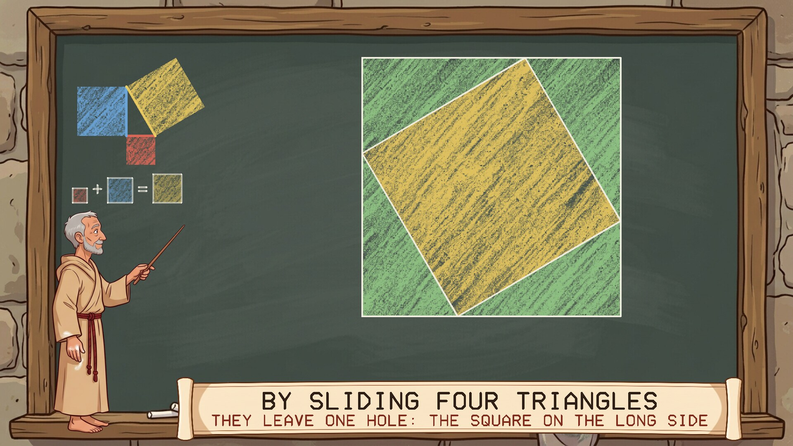
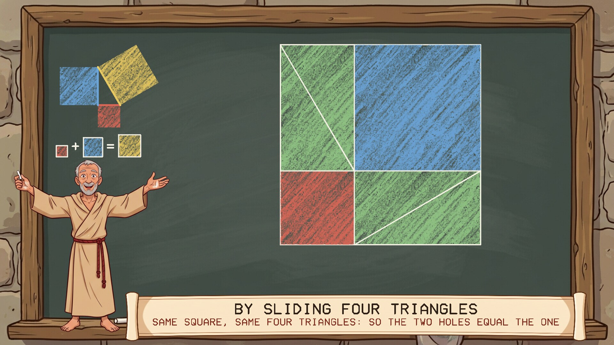
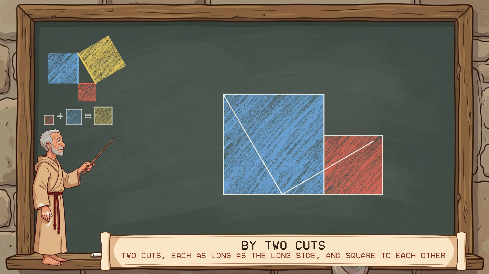
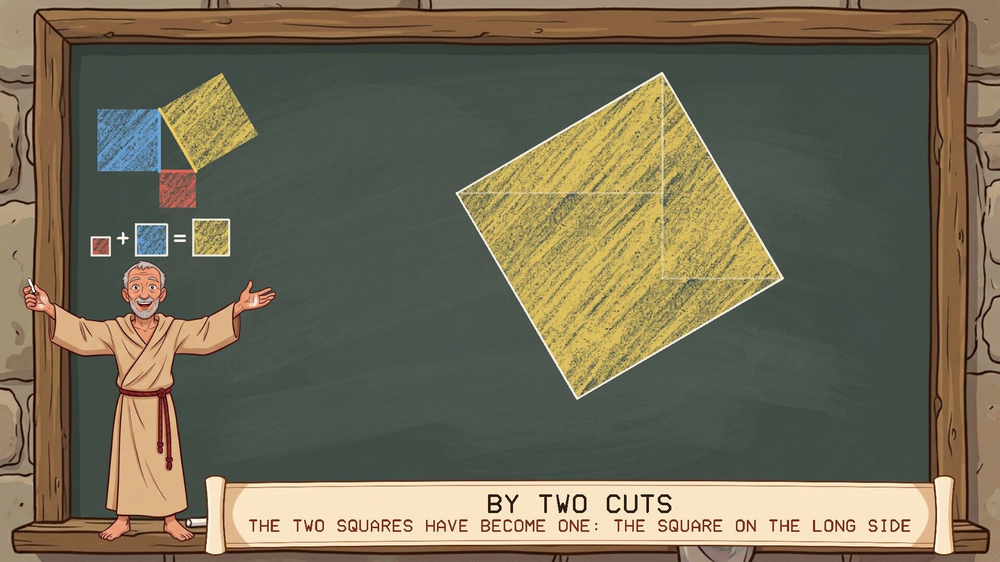
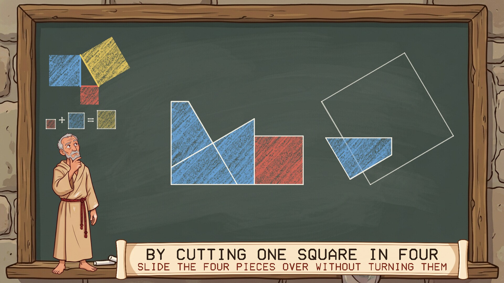
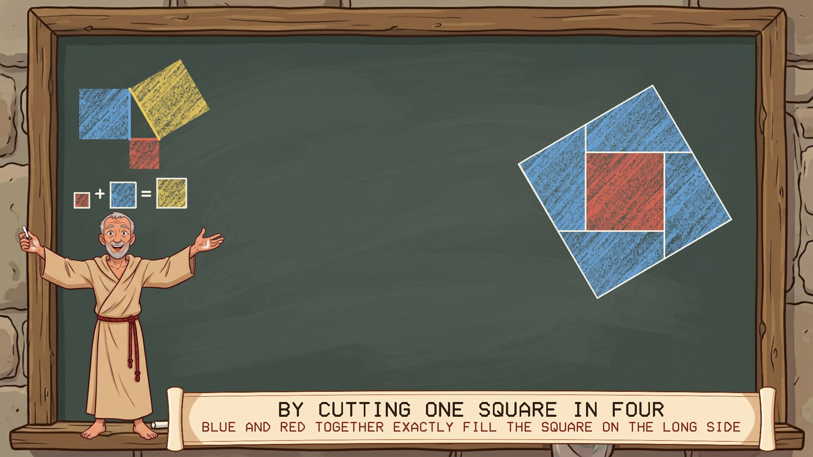
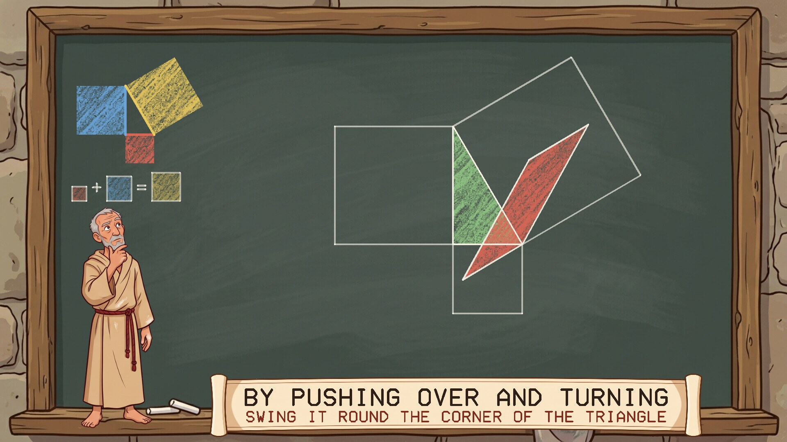
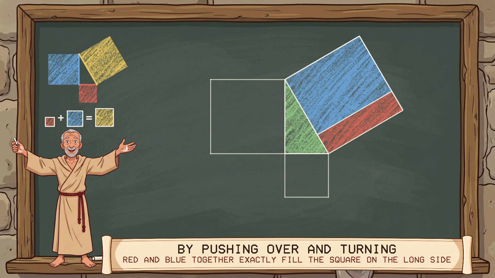

# The Adrakhonic Theorem

A screensaver that proves the Adrakhonic theorem, from Neal Stephenson's novel
*Anathem*, four ways in coloured chalk. Runs on Linux, Windows and macOS. One of the [Anathem screensavers](https://github.com/mottipython/anathem-screensavers).

## The theorem

In *Anathem* the Adrakhonic theorem is what we call the theorem of Pythagoras: in a
triangle with a square corner, the square on the long side is as big as the squares
on the other two sides together. It is the proof the Geometers painted on the hull
of their ship, which is how they got their name.

## What the screensaver shows

A fraa at a slate, and a different triangle every round. A key stays in the corner
of the slate throughout: the triangle with each side in its own colour and its
square in the same colour. Red is always the square on the short side, blue the one
on the middle side, and gold the one on the long side. Under it is the claim in
pictures, red square + blue square = gold square, drawn at their true sizes; it
brightens each time a proof arrives at it.

Then four proofs, each about half a minute. In all of them the pieces only slide,
turn, or are pushed over sideways, none of which changes how much slate they cover.

| | |
|---|---|
|  |  |
| **Sliding four triangles.** Four copies of the triangle in a square leave one hole, the gold square. | Slide three of them and the same square, with the same triangles, has two holes: the red and the blue. |
|  |  |
| **Two cuts.** The red and blue squares side by side, cut twice. | Slide the two triangles round and they make one square, on the long side. |
|  |  |
| **Cutting one square in four.** The blue square is cut through its middle, along the long side and across it. | The four pieces slide over without turning, and the red square fills the middle. |
|  |  |
| **Pushing over and turning.** A square pushed over sideways keeps its base and height, so its size. Swing it round and push it over again. | Red and blue each become an upright strip of the gold square, and fill it between them. |

The figures are worked out exactly for each triangle, so the pieces really do fit;
nothing is nudged to look right.

### What is from the book and what is mine

From the book: the name of the theorem, and that it is this one. The fraa at a
slate with chalk is how theorics is done in a math.

Mine: the choice of these four proofs, which are all old ones from our own world
(the last is Euclid's), the colours, and the wording.

## Install

Packages are on the [releases page](../../releases).

### Windows

Run `Adrakhonic-Setup-1.0.0.exe`. It asks for administrator rights, because Windows
only lists screensavers that are in its own system folder. After that "The Adrakhonic
Theorem" is in Screen Saver Settings with the others, already selected. Uninstall from
Apps.

### macOS

For Apple Silicon and Intel, macOS 11 or later. The quick way is to paste this into
Terminal. It installs the screen saver for your user and opens the Screen Saver
settings, where it is at the end of the list:

    curl -fsSL https://raw.githubusercontent.com/mottipython/anathem-screensavers/main/tools/mac-install.sh | sh -s -- adrakhonic

Leave off `-s -- adrakhonic` to install all the
[Anathem screensavers](https://github.com/mottipython/anathem-screensavers) at once,
or put `--uninstall` in its place to take them off again.

To do it by hand, download the file ending `-mac-screensaver.zip` from the releases
page, unzip it and double-click the `.saver` file. It is not signed with an Apple
developer certificate, so macOS will refuse it at first: open System Settings,
Privacy & Security, and click Open Anyway. (The command above avoids that step.)
The file ending `-mac.zip` is the same thing as an ordinary app that runs full
screen until you press a key.

**Tested on** macOS 15 (Intel), Windows 11 and Fedora-based Linux (Nobara 44, KDE
Plasma on Wayland): it installs, shows up as a screen saver and runs on all three.
The `.deb` is installed and run by an automated test on Ubuntu 24.04, Ubuntu 25.04,
Debian 13 and Mint 22. Apple Silicon has not been tried yet; reports are welcome.

### Linux

**Fedora, Nobara** (built on Fedora 44):

    sudo dnf install ./adrakhonic-1.0.0-1.fc44.x86_64.rpm

**Debian, Ubuntu, Mint** (Ubuntu 24.04 / Debian 13 or later):

    sudo apt install ./adrakhonic_1.0.0_amd64.deb

From your next login it starts by itself after five minutes idle, and any key or
mouse movement ends it. To start the watcher without logging out, or to change the
delay:

    adrakhonic-screensaver enable 10    # after 10 minutes idle
    adrakhonic-screensaver disable
    adrakhonic-screensaver status
    adrakhonic-screensaver now          # run it right away

Wayland desktops have no screensaver service to plug into, so the package starts a
small idle watcher (`swayidle`) at login. It works on compositors that provide the
ext-idle-notify protocol: KDE Plasma, Sway, Hyprland, niri, COSMIC, labwc and
others. GNOME does not provide it, and on X11 you would add `adrakhonic` to
xscreensaver or your desktop's own idle settings. It does not lock the screen. If
one of the other *Anathem* screensavers
([Teglon](https://github.com/mottipython/teglon),
[the Lazy Peregrin](https://github.com/mottipython/lazy-peregrin),
[Cutting the Cake](https://github.com/mottipython/cutting-the-cake),
[the Clock of Saunt Edhar](https://github.com/mottipython/edhar-clock),
[the Weed War](https://github.com/mottipython/weed-war),
[the Daban Urnud](https://github.com/mottipython/daban-urnud)) is already on screen it stays out of the way.

## Running it yourself

    adrakhonic              full screen on every display; any key or mouse movement quits
    adrakhonic --window     in a window; Esc or Q quits
    adrakhonic --speed 2    faster
    adrakhonic --seed 7     a particular triangle
    adrakhonic --snapshot out.bmp --time 60 --size 1920x1080

## Building

Needs a C compiler, make and SDL2 (2.0.18 or newer). Build from the top of the
source tree, because the pictures in `assets/art` are built into the program.

    make
    make check
    sudo make install

Packages are written to `dist/`. `tools/Containerfile` describes a container with
everything they need:

    podman build -t anathem-build -f tools/Containerfile tools
    podman run --rm --security-opt label=disable -v "$PWD":/src -w /src anathem-build make dist

## Credits and licence

MIT. *Anathem* and the Adrakhonic theorem's name are Neal Stephenson's; this is an
unofficial fan project.

The pictures (the slate, the chalk, the fraa and the scroll) were drawn with Google
Gemini and prepared by `tools/make_sprites.py`. Images are decoded with
[stb_image](https://github.com/nothings/stb) (public domain).
